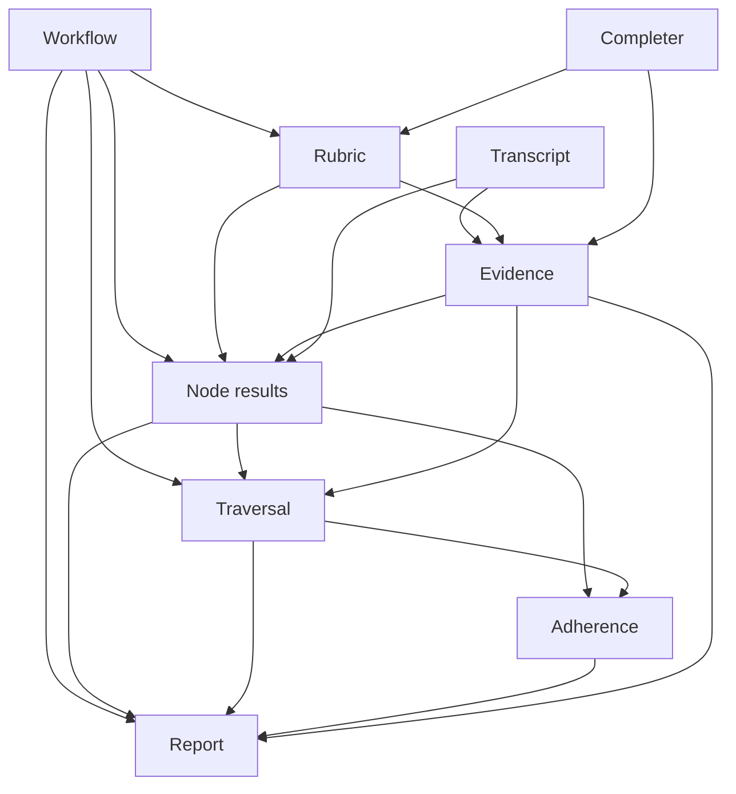

# veriflow

## Problem and Responsibilities

Veriflow checks whether a conversational assistant followed a directed workflow.

- The model interprets language.
- Python decides structure, status, path, and score.
- The check separates what the assistant did, what the workflow required, and which edges the graph allows.

## Requirements and Assumptions

- Python 3.12.
- One OpenAI model.
- `OPENAI_API_KEY` and `OPENAI_MODEL` live only in `.env`.
- The graph has one start node, is directed and acyclic, and has at least one reachable end node.
- Transcript roles are `user` and `assistant`.
- Turn order is the file order, including overlapping intervals.

The `ASSIGNMENT` case in [fixtures/case_catalog.json](fixtures/case_catalog.json) is an interpretation of the original conversation.

## Installation and Execution

- Create a virtual environment with `python3.12 -m venv .venv`.
- Activate it with `source .venv/bin/activate`.
- Install the package with `pip install -e .`.
- Copy [.env.example](.env.example) to `.env` and set the key and model.

```bash
python main.py \
  --graph fixtures/assignment_graph.json \
  --transcript fixtures/assignment_transcript.json \
  --output examples/assignment_result.json
```

- Exit 0 writes the report.
- Exit 1 writes `{"error": {"outcome", "code", "message"}}` for `ContractError` or `JudgeError`.
- Exit 2 means the output directory is missing, and no file is written.

The checked-in sample is [examples/assignment_result.json](examples/assignment_result.json).

## Algorithm and Split

The same words can be a paraphrase, an explanation, a promise, a quotation, or a correction. An edge, a status, and a score stay fixed when the findings stay fixed.

- The model returns findings. Path, status, and score stay in Python.
- Invalid judge JSON is repaired once. A second failure is `model_unavailable`, `model_refusal`, `invalid_rubric`, or `invalid_evidence`.
- Keyword matching misses paraphrase, explanation, promise, quotation, and correction.
- A model-owned score would change even when the findings stayed the same.



- [src/inputs.py](src/inputs.py) loads the graph and the transcript.
- [src/rubric.py](src/rubric.py), [src/prompts.py](src/prompts.py), and [src/openai.py](src/openai.py) build the rubric.
- [src/evidence.py](src/evidence.py) records findings and stage events.
- [src/nodes.py](src/nodes.py) assigns one status per node.
- [src/traversal.py](src/traversal.py) checks the path.
- [src/score.py](src/score.py) computes the score and the verdict.
- [src/report.py](src/report.py) writes the JSON.

[src/evaluate.py](src/evaluate.py) fixes that order.

## Semantic Evidence

Each node description becomes the obligations the transcript is judged against.

- Criteria come from that description.
- Binding shapes set the minimum split.
- `source_text` is an excerpt of that description.
- `exact_wording` is true only when the description demands those words.
- Results are `met`, `unmet`, `contradicted`, and `insufficient`.
- Applicability is `applicable`, `not_applicable`, and `uncertain`.
- Paraphrase can meet a criterion.
- The settled correction is the value that counts.
- Caller speech can establish a requested fact.
- An assistant action needs an assistant turn.
- Describing a procedure leaves that action unmet.
- Promising a procedure leaves that action unmet.
- Quoting someone else leaves the quoted action unmet.
- A spoken confirmation is evidence of the conversation only.

An empty transcript is judged locally, with no model call.

## Applicability

- Statuses are `completed`, `partial`, `incorrect`, `skipped`, `not_applicable`, and `not_reached`.
- Precedence is applicability, then a contradiction, then full completion, then partial progress, then a skip when there was an opportunity, otherwise `not_reached`.

## Traversal

- Node 4 is on the path only when an exception applies.
- The complete paths are `1-2-3-5` and `1-2-3-4-5`.
- The expected path is the single complete path consistent with branch applicability.
- An uncertain branch leaves `expected_path` null.
- Observed stages are assistant events after a predecessor was entered.
- Repeating the current stage is the same visit.
- A return to an open ancestor before an end node continues that stage. Recovery keeps the open stage and adds no edge from `4` to `3`.
- Hop assessments are `permitted`, `invalid`, and `unresolved`.
- Path validity is `invalid` when any hop is invalid.
- Path validity is `indeterminate` on a tie or an unestablished branch.
- Path validity is `valid` when the observed path equals the expected path.
- Path validity is `incomplete` for a proper prefix that has not reached an end.
- Any other mismatch is `invalid`.

## Scoring

Each in-force node on the established path contributes satisfied applicable criteria divided by applicable required criteria. The adherence score is the mean of those ratios, times the share of observed hops marked `permitted`, times 100, rounded half up to cents.

- `not_applicable`, `not_reached`, and a node with no applicable criteria contribute no ratio.
- With no observed hop, the transition factor is 1. A completed verdict still requires a complete path.
- With no established path, or no ratios, the score is null.

The first matching verdict wins.

- `failed`: an invalid path or an `incorrect` node.
- `indeterminate`: the branch is not established.
- `incomplete`: the path is not valid, or an expected node is `not_reached`.
- `partial`: credit is missing.
- `completed`: a valid path with full credit.

A high ratio leaves a material contradiction visible as `failed`.

The checked-in run is 3/3, 3/4, 5/5, and 4/4 on a valid path. Node 4 is `not_applicable`. The score is 93.75 and the verdict is `partial`.

## Edge Cases

- Paraphrase, multi-turn facts, and one turn covering several criteria.
- Volunteered details, repetition, and corrections.
- Overlapping speech kept in file order.
- Optional exceptions, and early end distinguished from omission.
- An empty transcript, with a null score.

These inputs fail before judgment:
- Malformed JSON or a missing field.
- An unsupported role, an invalid timestamp, or a decreasing turn start.
- A duplicate node id or a dangling edge.
- A cycle, more than one start node, or no reachable end node.

## Limits

- No drawing of the conversation.
- No backend or persistence check.
- No second booking cycle.
- No re-entry after the end node.
- An unsettled branch has a null score.
- Temperature 0.0 still allows wording to change across model revisions.

[fixtures/case_catalog.json](fixtures/case_catalog.json) defines ASSIGNMENT plus C01 through C47. A null transcript fixture is a specification. Runnable files:

- [fixtures/scenarios/returning_patient_transcript.json](fixtures/scenarios/returning_patient_transcript.json)
- [fixtures/scenarios/unavailable_slot_accepted_transcript.json](fixtures/scenarios/unavailable_slot_accepted_transcript.json)
- [fixtures/scenarios/procedure_explanation_transcript.json](fixtures/scenarios/procedure_explanation_transcript.json)
- [fixtures/scenarios/omitted_appointment_determination_transcript.json](fixtures/scenarios/omitted_appointment_determination_transcript.json)
- [fixtures/scenarios/overlapping_intervals_transcript.json](fixtures/scenarios/overlapping_intervals_transcript.json)
- [fixtures/scenarios/empty_transcript.json](fixtures/scenarios/empty_transcript.json)
- [fixtures/scenarios/malformed_json.txt](fixtures/scenarios/malformed_json.txt)
- [fixtures/scenarios/duplicate_node_ids_graph.json](fixtures/scenarios/duplicate_node_ids_graph.json)
- [fixtures/scenarios/cyclic_graph.json](fixtures/scenarios/cyclic_graph.json)

## Reproduce the Original Result

Repeat the command in Installation and execution. Compare a new run with [examples/assignment_result.json](examples/assignment_result.json).

- `overall.verdict`
- `overall.path_validity`
- `overall.adherence_score`
- `observed_path`
- each `node_results.*.status`

The checked-in file was produced with `gpt-4.1` at temperature 0.0. Verdict is `partial`, path validity is `valid`, and the adherence score is 93.75. The observed path is `1`, `2`, `3`, `5`. Node statuses are `completed`, `partial`, `completed`, `not_applicable`, and `completed`.

## Result JSON

- `overall`
- `expected_path`
- `observed_path`
- `transitions`
- `node_results`
- `deviations`
- `uncertainty`

Each `node_results` entry has status, applicability, score, evidence turns, missing and violated ids, an explanation, and the criteria worth showing.

The sample file is the full document.
